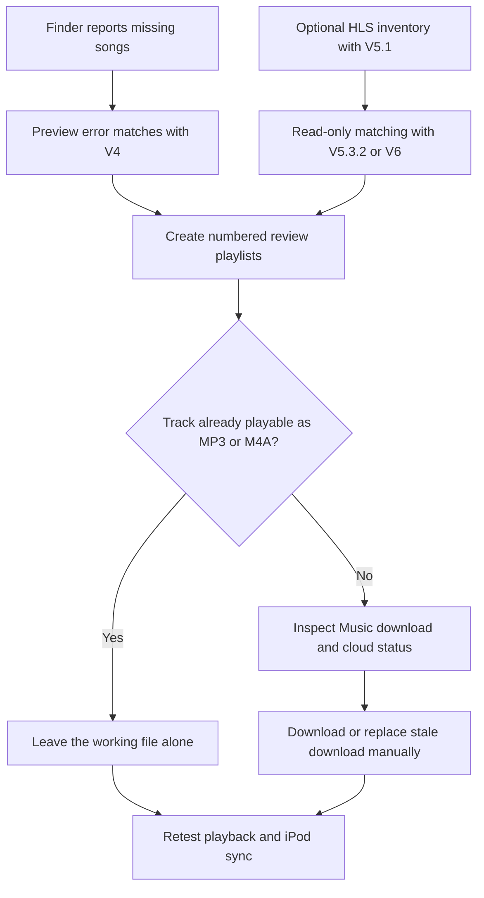

# iPod Music Sync Repair

**A macOS Python toolkit for investigating Apple Music and classic iPod sync failures.**

Turn Finder's *“could not be found”* song errors into manageable review playlists, inventory Apple Music HLS (`.movpkg`) downloads, and match leftover packages to songs in your Music library.

**macOS · Music.app · Finder iPod syncing · Python 3.9+ · Unofficial community project**

> **Project status:** Successfully used during one documented iPod Video 5.5 repair in November 2026. This is a collection of workflow-specific utilities, **not** a one-click repair app. Some later scripts expect the exact reports and filenames from that repair. Read the [limitations](#known-limitations) before running them on your library.

## What can it do?

- **Parse Finder sync errors** and organize missing songs into numbered Music playlists for review.
- **Inventory HLS downloads** (`.movpkg` directories), including paths and logical disk usage.
- **Classify candidate tracks** against Music library metadata, with read-only scanning before optional playlist creation.
- **Search the full Music library** by title, artist, album, and persistent ID, including track objects missed by file-only audits.
- **Flag ambiguous matches**, alternate album editions, and duplicate candidates rather than silently treating every match as correct.
- **Document a repeatable manual repair workflow** while keeping media deletion out of the mainline tools.

The toolkit **does not** remove Apple Music DRM, convert subscription-protected audio to transferable files, or guarantee that a matched song can sync to an iPod.

## Contents

| Tool | Purpose | Read-only by default? |
| --- | --- | --- |
| [`ipod_repair_batch_v4.py`](scripts/ipod_repair_batch_v4.py) | Parse Finder error text and create numbered repair playlists | Use `--preview` to inspect before creating playlists |
| [`ipod_music_repair_v5_1.py`](scripts/ipod_music_repair_v5_1.py) | Inventory `.movpkg` packages and report disk usage | Yes for `--scan-hls` |
| [`ipod_music_repair_v5_3_2.py`](scripts/ipod_music_repair_v5_3_2.py) | Scan bounded slices of an HLS inventory; optionally queue verified matches | `scan` is read-only; `queue` requires explicit opt-in |
| [`ipod_hls_finish_all.py`](scripts/ipod_hls_finish_all.py) | Organize batches for the V5.3.2 workflow | Inspect hardcoded paths first |
| [`ipod_hls_v6_library_match.py`](scripts/ipod_hls_v6_library_match.py) | Match a leftover report against all Music track objects | Yes; playlist creation requires `--create-playlists` |
| [`ipod_hls_review03.py`](scripts/ipod_hls_review03.py) | Build a best-effort review playlist for ambiguous versions | No; creates a playlist |
| [`scripts/legacy/`](scripts/legacy/) | Earlier experiments retained for reference | Not recommended as a starting point |

For development history, see [CHANGELOG.md](CHANGELOG.md) and [release notes](RELEASE_NOTES.md).

## Requirements

- A Mac with the **Music** app and Finder-based iPod syncing.
- **Python 3.9+**; these scripts do not require third-party Python packages.
- Terminal permission to control Music when prompted. Check **System Settings → Privacy & Security → Automation** if AppleScript access is denied.
- A backup of your Music library database, playlists, and important audio files before attempting repairs.

Tested in the documented workflow with an **iPod Video 5.5**. Other iPod models and macOS versions have not been systematically validated.

## Quick start

### 1. Get the code

```bash
git clone https://github.com/fixelzero/ipod-music-sync-repair.git
cd ipod-music-sync-repair
python3 --version
```

> **Path note:** Several scripts were written around files in `~/Downloads/` and `~/Desktop/iPod Repair Batches/`. Running from a cloned repository does **not** automatically make every script portable. Review the script's paths and arguments before execution; the commands below mirror the documented workflow.

### 2. Repair songs reported missing by Finder (V4)

Save Finder's missing-song error text as a plain-text file, for example `~/Downloads/Errors.txt`.

Preview a batch **without creating a playlist**:

```bash
python3 scripts/ipod_repair_batch_v4.py "$HOME/Downloads/Errors.txt" --preview --batch 1
```

After reviewing the matches, create that batch's playlist:

```bash
python3 scripts/ipod_repair_batch_v4.py "$HOME/Downloads/Errors.txt" --batch 1
```

Choose an unused batch number for later runs. Review every generated playlist in Music: V4's title-based matching can select the wrong version. V4 also has a known AppleScript argument issue with titles beginning with `-`.

### 3. Inventory HLS packages (V5.1)

```bash
python3 scripts/ipod_music_repair_v5_1.py --scan-hls
```

The documented workflow wrote inventory CSVs to `~/Desktop/iPod Repair Batches/`, using names such as `hls_inventory_YYYYMMDD_HHMMSS.csv`. A `.movpkg` count is a **package count, not necessarily a unique-song count**.

### 4. Scan a small inventory batch (V5.3.2)

Use the actual CSV filename from the preceding step:

```bash
python3 scripts/ipod_music_repair_v5_3_2.py scan \
  "$HOME/Desktop/iPod Repair Batches/hls_inventory_YYYYMMDD_HHMMSS.csv" \
  --start 0 --limit 25
```

This `scan` operation is read-only. Inspect its report and the tool's `queue --help` before explicitly creating playlists. Do not queue ambiguous matches without review.

### 5. Library-wide matching (V6 — advanced, session-specific)

V6 was built for a **327-row leftover report** named `hls_leftovers_final_scan.csv` in `~/Desktop/iPod Repair Batches/`. It is **not a general-purpose scanner for arbitrary inventories** without modifying its source.

In the original workflow, the script was run from `~/Downloads/`:

```bash
# Requires the expected leftover report and paths from the documented workflow.
python3 "$HOME/Downloads/ipod_hls_v6_library_match.py" --report-only

# Only after inspecting the report:
python3 "$HOME/Downloads/ipod_hls_v6_library_match.py" --create-playlists
```

V6 uses four bulk Music metadata queries (name, artist, album, persistent ID) and normalizes case, Unicode, and punctuation. Exact metadata matches are **not** proof of a valid AAC download. The script also relies on fixed output and playlist names; review its source before reusing it.

`ipod_hls_review03.py` depends on the V6 report and a copy of `ipod_hls_v6_library_match.py` in `~/Downloads/`. Its selection of ambiguous versions is **best effort** and may choose a different release or recording.

## How the repair process works



### Manual download repair

1. Verify the **title, artist, album/version, and file location** of each candidate.
2. Leave already-working **MP3/M4A** files alone.
3. Download cloud-available tracks that have no local file.
4. For a confirmed stale download, choose **Remove Download**, **not Delete from Library**, and then download again. Use Music's **High Quality (AAC 256 kbps)** download setting when appropriate.
5. Test playback and retry the iPod sync. Playlist creation alone does not prove a song is compatible with the device.

**DRM note:** Apple Music subscription downloads can remain protected and unsuitable for classic iPods. Selecting AAC download quality does not remove DRM or create ownership rights. Only sync audio you are authorized to transfer.

## Real-world repair results

This toolkit grew out of a November 2026 repair of a modded **iPod Video 5.5** and a large Apple Music library.

| Observation | Result |
| --- | ---: |
| Music library track objects | 24,321 |
| File tracks | 10,244 |
| Other track objects | 14,077 — not necessarily all cloud-only |
| Initial HLS inventory | 1,552 packages / 60.86 GiB |
| Intermediate HLS inventory | 803 packages / 32.54 GiB |
| Final leftover HLS inventory | 327 packages / 14.22 GiB |
| Active `.movpkg` references among file tracks at final audit | 0 |
| V6 classification | 49 exact; 26 title/artist; 22 ambiguous versions; 5 ambiguous exact; 225 not found |
| Final Repair 01 | 22 tracks reviewed and repaired |
| Review 02 | 25 unique tracks reviewed; already MP3/M4A |
| Review 03 | 24 unique tracks reviewed |
| Final leftover package cleanup | 327 manually deleted after path-set validation; 0 remained |
| Available storage after final cleanup | 62 GiB → 76 GiB |

**Interpretation:** The final file-track audit covered **10,244 file tracks**, not every possible Music track type. Deleting the 327 packages was a separate, explicitly confirmed, user-specific action; it is **not automated by this repository**. A final post-cleanup playback and iPod sync verification was not documented. These outcomes should not be generalized to other libraries.

Read the full sequence in [Repair Journey](docs/REPAIR_JOURNEY.md).

## Known limitations

- **Workflow-specific paths:** V5/V6-era scripts may assume particular input files, output directories, playlist names, and previous reports.
- **V6 is not portable out of the box:** It expects the original 327-row report and does not accept arbitrary inventories without code changes.
- **Metadata is not identity:** Similar titles, live recordings, remasters, alternate albums, and Unicode variations can produce incorrect matches.
- **Multiple packages can match one track:** A playlist may contain fewer entries than the number of package rows.
- **File-track audits are incomplete by design:** Zero `.movpkg` references among file tracks does not prove every package is unused by all other Music track types.
- **Finder errors may appear in waves:** Fixing one set can expose more errors; no verified universal error-count cap was established.
- **Known V4 edge case:** AppleScript argument handling can fail for titles beginning with a hyphen.
- **No automatic conversion or cleanup:** The toolkit does not bypass DRM and intentionally does not include a reusable permanent-deletion script.

For device-side issues such as a stalled Finder sync, see [Troubleshooting](docs/TROUBLESHOOTING.md). In the documented repair, an `iTunesLock` file was **not** present on the mounted device; removing such a file should not be treated as a universal fix.

## Safety and privacy

- Start with **read-only** commands and inspect generated CSVs before making playlists.
- Back up your Music library and important audio before changing downloads or device contents.
- Do not remove `.movpkg` directories solely because a metadata matcher labels them `NOT_FOUND`.
- Never confuse **Remove Download** with **Delete from Library**.
- Do not publish real sync-error exports, listening histories, persistent IDs, or personal filesystem paths in GitHub issues.

See [Safety](docs/SAFETY.md) for more context. Repository examples use synthetic data; inspect scripts for fixed filenames before running or forking.

## Documentation

- [Changelog](CHANGELOG.md) — version-by-version history
- [Release notes](RELEASE_NOTES.md) — release overview
- [Repair journey](docs/REPAIR_JOURNEY.md) — the complete case study
- [Troubleshooting](docs/TROUBLESHOOTING.md) — Finder, Music, and device issues
- [Safety](docs/SAFETY.md) — backups, verification, and cleanup precautions
- [Example inputs](examples/README.md) — synthetic samples

## Contributing

Bug reports, reproducible test cases, documentation fixes, and improvements to path handling or matching logic are welcome through [GitHub Issues](https://github.com/fixelzero/ipod-music-sync-repair/issues) and pull requests. Please **redact personal music-library information** from logs and reports.

Useful next improvements include configurable input/output paths, automated tests for Unicode and duplicate handling, fixing V4's leading-hyphen edge case, and making V6 accept arbitrary inventories.

## License

[MIT License](LICENSE). Unofficial community project; not affiliated with or endorsed by Apple.
